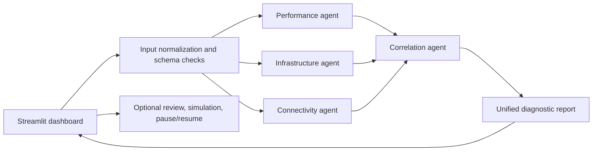

# NetCoop AI | Network diagnostics

A runnable Streamlit dashboard for topology-aware network diagnosis by **deterministic rule-based agents**. The demo uses synthetic telemetry from the Colab generator linked in the hackathon brief; no production network is contacted or modified.

The dashboard's visual direction follows Garam Prix's high-contrast black canvas, oversized glowing hero title, live-status capsule, split scorecard, and bold cyan section headings. It uses NetCoop-specific labels, colors, and content rather than the site's sports assets.

## Quick start

Install Python 3.11 or later, then run:

   ```bash
   python -m venv .venv
   # Windows: .venv\Scripts\activate
   # macOS/Linux: source .venv/bin/activate
   pip install -r requirements-dev.txt
   streamlit run app.py
   ```

Choose a scenario in the left sidebar. The topology animates packet flow and the dashboard reports a diagnosis. `make demo` regenerates the fixture and launches the dashboard; `make test` runs regression tests.

## Two-minute quick start

1. Create an environment and install dependencies: `python -m venv .venv && pip install -r requirements-dev.txt` (activate `.venv` on Windows with `.venv\\Scripts\\activate`).
2. Run `make demo` (Windows users can run `python -m netcoop.data_generator --output data/sample_telemetry.json` followed by `streamlit run app.py` if Make is unavailable).
3. Select **Link congestion** and inspect the highlighted path, plain-language evidence, and recommended check.
4. Select **Interoperability failure** to see schema and unit warnings and a lower confidence score.

## What is included

- Five distinct agents: performance, infrastructure, connectivity, fault correlation, and recommendations/reporting.
- Versioned JSON agent envelopes with documented fields, units, validation, and a message trace.
- A topology diagram with continuously animated packets and a highlighted affected segment.
- Sample data for healthy operation, latency spike, hardware failure, link congestion, weak Wi-Fi, interface fault, DNS/DHCP service issue, and an interoperability failure.
- A malformed telemetry case, explicit missing-evidence handling, and structured diagnostic report export.
- Reproducible acceptance checks under `tests/` (`python -m unittest discover -s tests -v`).
- Optional MCP server (`mcp_server.py`) with scenario/report tools and protocol/sample dataset resources.
- Human review capture, SQLite pause/resume checkpoints, and a remediation simulation log that never changes a device.

## Architecture



`app.py` loads a selected sample or uploaded JSON/CSV, runs the orchestrator, and renders the report, topology, agent trace, and telemetry. `netcoop/agents.py` contains five deterministic specialist agents. Each sends an `agent_message_v1` envelope with `message_id`, `timestamp`, `source_agent`, `target_agent`, `schema_version`, `status`, `findings`, `evidence`, and `limitations`. Measurements use the field names and units from the synthetic data (`latency_ms`, `packet_loss_pct`, `link_utilization_pct`, `cpu_utilization_pct`, `queue_drops`, `interface_errors`, `jitter_ms`, and `signal_strength_dbm`).

The orchestrator collects the specialist messages before invoking the correlation agent. Correlation ranks candidate causes from independent evidence families, caps confidence when evidence is sparse or conflicting, and returns `insufficient_evidence` if the score is below the documented threshold. The reporting agent creates a report with the fields required in the challenge: incident ID, status, suspected cause, confidence, affected devices, supporting evidence, alternative causes, recommended actions, evidence sources, and limitations. Findings are recommendations for an operator; remediation simulation only records a preview and never executes network commands.

## Deterministic rule-based agents and confidence

Confidence is an evidence score, not a calibrated probability. Duplicate records are removed before scoring, and corroboration is counted by distinct device and metric. A single evidence family can diagnose when at least three independent signals agree; that confidence is capped at 0.55. Close candidates within 0.05 are reported as ambiguous. Full penalty definitions and scenario expectations are in [`docs/ACCURACY.md`](docs/ACCURACY.md).

| Confidence penalty | Amount |
|---|---:|
| Unsupported schema version | -0.15 |
| Each ignored metric | -0.05 (maximum -0.20) |
| Device absent from topology | -0.10 |
| No usable topology | -0.10 |

## Input and error handling

Upload a JSON object or a CSV with one row per device. Canonical metric names are preferred; common aliases such as `latency`, `packet_loss`, and `link_utilization` are normalized. Unknown units and invalid numeric ranges are excluded with warnings; missing metrics remain missing and cannot count as supporting evidence. The interoperability demo intentionally supplies an unknown schema version and incompatible unit. Invalid JSON, empty files, and absent metrics produce a visible input error or an insufficient-evidence report, not a fabricated diagnosis.

CSV columns: `timestamp`, `device_id`, `device_type`, `site`, `status`, followed by metric columns. Optional topology is represented in JSON as a `topology` object containing `devices` and `links` arrays.

## Synthetic data and test scenarios

The [Colab notebook linked in the hackathon brief](https://colab.research.google.com/drive/1xFOtO114qWICAxGisK9K6oOHoOxwvGi1) is included as `colab_generator.ipynb`; open it in Google Colab and run its single cell to generate baseline telemetry. The local dashboard is reproducible without Colab and does not need an API key. Run `python -m netcoop.data_generator --output data/sample_telemetry.json` to regenerate the bundled demo fixture. The metric values use a fixed seed (`20261031`) for repeatable scenarios. See [`docs/SYNTHETIC_DATA.md`](docs/SYNTHETIC_DATA.md) for the generation method and ranges.

The dashboard does not replay a pre-written report. `data/sample_telemetry.json` contains fixed synthetic readings for each demo scenario. Selecting a scenario passes its record to the agents and correlator, which calculate findings, confidence, affected devices, and recommendations from the measurements. The system is labeled **deterministic rule-based agents**. Selecting the same fixture again produces the same diagnosis; use an uploaded telemetry file to analyze different data.

## Optional workflow features

- **MCP:** run `mcp run mcp_server.py` for a local stdio server, or `mcp dev mcp_server.py` to inspect the tools/resources. Tools list scenarios and diagnose either uploaded JSON text or a named demo scenario; resources expose the protocol and sample dataset.
- **Human review:** save an operator decision and note against the incident report.
- **Pause/resume:** save the active input, report, agent messages, and scenario to `state/netcoop_workflows.sqlite3`; select it in the sidebar to resume.
- **Remediation simulation:** record a proposed action preview and result in the local event log. The simulator never connects to devices or sends commands.

The SQLite file persists on the app's local filesystem. Hosting platforms with ephemeral filesystems may clear it on rebuild/restart; mount a persistent disk or configure a managed database for durable hosted deployments.

Scenarios are synthetic and are not campus measurements. DNS/DHCP scenarios model service-specific failure via `service_status`; the notebook itself does not generate service telemetry, so this is an explicit extension for the brief's suggested scenario.

## Project files

- `app.py` — Streamlit dashboard.
- `netcoop/agents.py` — message protocol, validation, agents, orchestration, and report assembly.
- `netcoop/data_generator.py` — Colab-derived synthetic generator and scenario extensions.
- `netcoop/workflow_store.py` — SQLite checkpoint, review, and simulation event store.
- `mcp_server.py` — optional MCP tools and resources.
- `tests/` — reproducible acceptance checks.
- `data/sample_telemetry.json` — generated demo scenarios.
- `docs/AGENT_PROTOCOL.md` — message contract, field definitions, units, and failure semantics.
- `docs/REQUIREMENTS_MATRIX.md` — implementation map for the hackathon checklist.
- `docs/SYNTHETIC_DATA.md` — generation steps, Colab ranges, and scenario extensions.
- `docs/schema.json` — JSON Schema for agent messages and diagnostic reports.
- `docs/ACCURACY.md` — expected scenario verdicts and confidence penalties.
- `colab_generator.ipynb` — source notebook linked from the PDF.

## Demo walkthrough

Select **Link congestion** and run diagnosis. Follow the animated path from gateway through the core switch to access devices, then inspect the performance and infrastructure evidence, the correlator's candidate ranking, and the JSON report. Switch to **Interoperability failure** to see schema/unit validation warnings and reduced confidence. Download the JSON report from the dashboard.

This prototype supports a reproducible live demo; record a three-to-five-minute screen capture separately if a demo video is required for submission.
