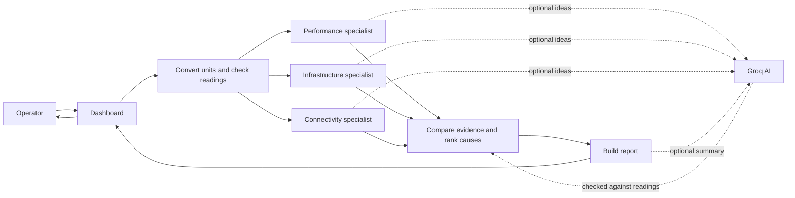
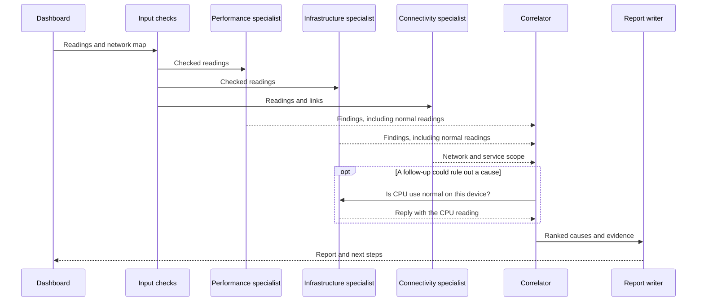

# NetCoop AI

NetCoop AI is a demo that checks network readings and suggests what to inspect. Small software helpers (called “agents”) compare different readings. The built-in readings are made up; the app does not connect to or change a real network.

## Start the dashboard

You need Python 3.11 or newer.

```powershell
python -m venv .venv
.\.venv\Scripts\Activate.ps1
pip install -r requirements-dev.txt
streamlit run app.py
```

On macOS or Linux, activate the environment with `source .venv/bin/activate`.

Choose a scenario or upload JSON/CSV telemetry. An upload takes priority over the selected scenario, and the dashboard shows a notice. Use the sliders to try different values; **Corrupt input** changes a field name and unit to demonstrate input handling.

## Reading the dashboard

- **Team conversation** shows how the helpers reached their result. Use the slider to replay the messages. **JSON report** contains the full result.
- **Network map** shows devices as boxes and connections as lines. Orange highlights the likely problem and devices downstream that may be affected.
- **Device readings** has one row per device. “Readings” counts its time samples; the summary combines unusual values across those samples. Repeated readings of the same device are expected.
- **Reading trends** show each reading as a dot, from older (left) to newer (right). Blue joins the values; dashed red is the alert limit. For Wi-Fi signal, values below the line are weak. For the other charts, values above it are high. Use each chart's **Help** button for a plain-language description.
- **Confidence** reflects how much useful evidence there is and its quality. It is not the chance that the result is right. High is 75% or more; Medium is 45–74%; Low is below 45%.

## How a diagnosis works

Each helper checks a different part of the network and reports normal readings too. The comparison step may ask a follow-up question, then ranks possible causes. Rules check the result. Optional Groq AI can suggest causes and write a summary, but cannot change the rule-based answer. It is off by default. When turned on, readings are sent to Groq.



The conversation follows this sequence:



## Accuracy and speed

The audit tried 1,000 made-up cases and named the main problem correctly in **792 (79.2%)**. One in five cases combined two problems. It had no crashes on malformed inputs. These results describe only the generated examples; they are not real-network accuracy. See the [full results](docs/ACCURACY.md).

The dashboard includes **86 synthetic readings**: 12 time points for each of seven scenarios, plus two input-quality examples. Each scenario follows one device over 44 minutes. This is a small demo dataset, not a representative network sample. See [how the sample data is made](docs/SYNTHETIC_DATA.md).

On the benchmark machine, diagnosis of 12 readings took **17.81 ms median** (18.12 ms P95). Larger stress inputs took 2.72 s for 338 records and 8.07 s for 1,000 records. Peak traced Python memory at 1,000 records was 17.34 MiB. These figures exclude HTTP calls and dashboard rendering and vary by machine. Full results and the rerun command are in [PERFORMANCE.md](docs/PERFORMANCE.md).

## Command line and agent service

Create a report without opening the dashboard:

```bash
python -m netcoop diagnose data/sample_telemetry.json --format md
python -m netcoop diagnose data/sample_telemetry.json --format json
```

Agents can also run as a separate HTTP service:

```bash
python -m netcoop.http_agents
```

Set `NETCOOP_AGENT_URL` to the service address before starting the dashboard to use it. The project also includes an MCP server: `mcp run mcp_server.py`.

## Checks and project files

```bash
python -m pytest tests -q
python scripts/accuracy_audit.py
python scripts/performance_benchmark.py
```

- `app.py` — Streamlit dashboard.
- `netcoop/agents.py` — input checks, specialist agents, and diagnosis.
- `netcoop/data_generator.py` — repeatable demo and audit data.
- `mcp_server.py` — MCP tools and resources.
- `tests/` — automated checks.
- `docs/` — protocol, accuracy, performance, and sample-data notes.

A recorded dashboard walkthrough is included as [demo.webm](demo.webm).
