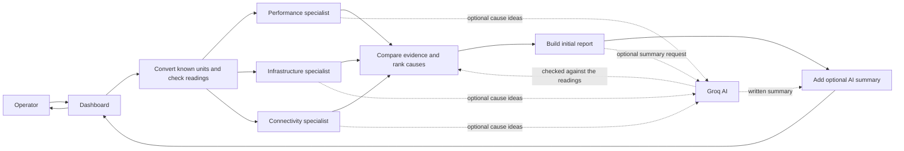
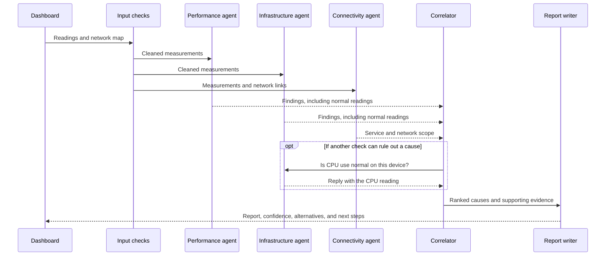

# NetCoop AI

NetCoop AI helps you explore possible network problems using sample or uploaded device readings. It shows the readings behind each suggestion, how the agents exchanged messages, and what an operator could check next.

This is a demo and analysis aid. Its built-in data is synthetic. It does not connect to campus equipment or make network changes.

## Start the dashboard

You need Python 3.11 or newer. From this folder, create and activate a virtual environment, then install the project requirements:

```powershell
python -m venv .venv
.\.venv\Scripts\Activate.ps1
pip install -r requirements-dev.txt
streamlit run app.py
```

On macOS or Linux, activate the environment with `source .venv/bin/activate` instead. Open the local address printed by Streamlit.

Choose a demo scenario in the sidebar, or upload a JSON or CSV file. An uploaded file takes priority over the selected scenario; the dashboard displays a banner when that happens. The what-if sliders let you try different readings. The **Corrupt input** button changes a field name and units so you can see how the app handles them.

The **Agent communication · replay** tab lets you step through the messages. The **JSON report** tab shows the structured report. The topology highlights affected devices and downstream scope; the metric panels show readings and thresholds.

## What the results mean

The rules compare device readings with configured thresholds. They can flag link congestion, weak Wi-Fi, interface faults, hardware problems, and DNS/DHCP service issues. Healthy readings are included in the agent conversation too, so a specialist can rule out a cause—for example, checking whether CPU use is normal.

The confidence score is an evidence score, not a promise that the diagnosis is correct. “High”, “Medium”, and “Low” are display bands (75% and 45% cutoffs). The score breakdown shows its starting score and deductions. The [randomized audit](docs/ACCURACY.md) reports how the rules performed on 1,000 generated cases, including misses and ambiguous results. Those results describe this synthetic test set; they are not real-world network accuracy.

## How a diagnosis moves through the app



The agents send messages as they work. The replay tab shows them in order:



## Use the command line

Create a report without opening the dashboard:

```bash
python -m netcoop diagnose data/sample_telemetry.json --format md
python -m netcoop diagnose data/sample_telemetry.json --format json
```

## Run agents as a separate service

The local HTTP service lets the dashboard or command line send requests to agents running as a separate service:

```bash
python -m netcoop.http_agents
```

In another terminal, set the service address before starting the app or CLI:

```powershell
$env:NETCOOP_AGENT_URL = "http://127.0.0.1:8765"
streamlit run app.py
```

The service has separate routes for the performance, infrastructure, connectivity, correlation, and reporting agents. An optional MCP (Model Context Protocol) server is available with `mcp run mcp_server.py`.

## Optional AI writing and ideas

The Groq option can suggest possible causes and write a short report summary. The regular rules check any suggested causes and keep control of the final verdict. No AI request is made unless you turn the option on. When enabled, device readings and evidence are sent to Groq; do not use sensitive telemetry unless that is allowed by your organization.

Set `GROQ_API_KEY` in your environment or Streamlit secrets to enable it.

## Run checks

```bash
python -m pytest tests -q
python scripts/accuracy_audit.py
```

The audit uses seeded random scenarios with varied readings, overlapping problems, missing fields, and malformed values. It writes the confusion matrix and confidence results to [`docs/ACCURACY.md`](docs/ACCURACY.md).

### What the evaluation shows

The audit generated **1,000 synthetic test cases**. Against each case's primary expected label, the diagnosis exactly matched in **792 cases (79.2%)**; it returned an alternative or abstained in the rest. The generator also combines faults in 20% of cases, so this strict single-label score does not credit every useful multi-fault answer. It had zero fuzz-input exceptions. The report includes a confusion matrix and confidence-score breakdown. These figures describe this generated test set only: they are not measured accuracy on a real network, and the runtime confidence score is not a verified probability.

The dashboard fixture is larger now: **338 synthetic readings**, comprising 48 timestamped points for each of seven scenarios plus two input-quality examples. Each scenario shows one device over 188 minutes. This makes the charts more useful in a demo, but it is not a representative, multi-site network dataset. Stronger real-world claims need labeled telemetry collected across devices and sites, with a separate holdout set.

### Diagnosis speed and memory

The benchmark in [`docs/PERFORMANCE.md`](docs/PERFORMANCE.md) measures full in-process diagnosis runs on this machine. A 48-reading scenario, the dashboard's diagnosis input size, took a median **63 ms** (P95 **65 ms**). A 338-record stress input took **2.72 s** median; 1,000 records took **8.07 s** median and **17.34 MiB** peak traced Python memory. The benchmark does not include HTTP calls or Streamlit rendering, and results depend on hardware and Python version. Re-run it with `python scripts/performance_benchmark.py` on the machine you want to measure.

## Data and input notes

The nine one-record scenarios used by tests and the command-line examples can be regenerated with:

```bash
python -m netcoop.data_generator --output data/sample_telemetry.json
```

To rebuild the dashboard's chart-ready sample history, run:

```bash
python -m netcoop.data_generator --timeseries --output data/demo_timeseries.json
```

Both files are synthetic examples, not readings from a real campus network. The dashboard refreshes their timestamps when it loads them so they do not appear stale. Timestamps in uploaded files are checked normally.

JSON may contain one record or a `records` list and an optional `topology`. CSV uses one row per device. Before diagnosis, the app converts known units and vendor field names and records each conversion. It rejects booleans and infinite or invalid numbers, warns when readings are missing, and lowers confidence for old readings or percentages that might have been entered as fractions.

## Project guide

- `app.py` — dashboard.
- `netcoop/agents.py` — input handling, agents, diagnosis, and report creation.
- `netcoop/http_agents.py` — local HTTP service for agent requests.
- `netcoop/model_agent.py` — optional Groq suggestions and report writing.
- `netcoop/data_generator.py` — repeatable sample data and randomized cases.
- `mcp_server.py` — optional MCP tools and resources.
- `tests/` — automated checks.
- `docs/AGENT_PROTOCOL.md` — message format and how agents work together.
- `docs/ACCURACY.md` — results from the 1,000-case synthetic audit.
- `docs/PERFORMANCE.md` — diagnosis speed and memory measurements.
- `docs/SYNTHETIC_DATA.md` — where sample readings come from.
- `docs/REQUIREMENTS_MATRIX.md` — a map from project goals to the implementation.

A recorded dashboard walkthrough is included as [`demo.webm`](demo.webm).
