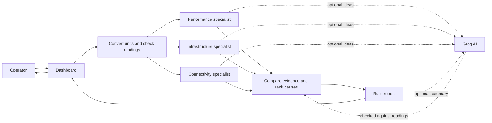
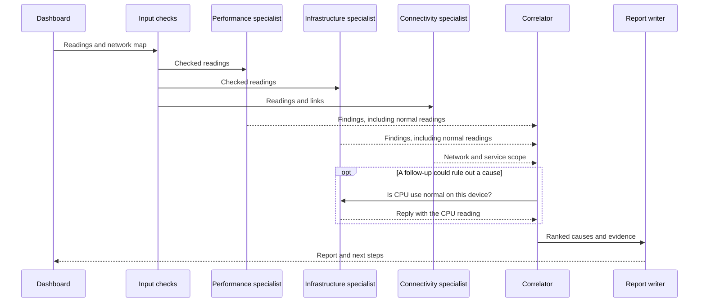

# NetCoop AI

NetCoop AI is a demo that checks network readings, asks specialist agents to compare them, and suggests what an operator should inspect. The built-in readings are synthetic; the app does not connect to or change a real network.

## Start the dashboard

You need Python 3.11 or newer.

```powershell
python -m venv .venv
.\.venv\Scripts\Activate.ps1
pip install -r requirements-dev.txt
streamlit run app.py
```

On macOS or Linux, activate the environment with `source .venv/bin/activate`.

Choose a scenario or upload JSON/CSV telemetry. An upload takes priority over the selected scenario, and the dashboard shows a notice. Use the sliders to try different values; **Corrupt input** changes a field name and unit to demonstrate input handling.

## Reading the dashboard

- **Agent messages** shows the specialists' conversation. Use the slider to replay it. **JSON report** contains the full structured result.
- **Topology** maps devices and links. Highlighted paths show the reported fault and downstream impact.
- **Telemetry snapshot** gives one row per device. “Readings” is the number of time samples; the observations summarize values that crossed alert thresholds.
- **Metric time windows** show readings from older (left) to newer (right). The blue line is the measured value; the red dashed line is its alert threshold. For Wi-Fi signal, values below the line are weak; for the other charts, values above it are high.
- **Confidence** reflects evidence coverage and input quality. It is not a probability that the diagnosis is correct. High is 75% or more; Medium is 45–74%; Low is below 45%.

## How a diagnosis works

The specialists report both unusual and normal readings. The correlator compares their evidence, may ask a follow-up question, and sends a ranked result to the report writer. Rules verify the result. The optional Groq feature can suggest hypotheses and write a summary, but it cannot change the rule-based verdict. It is off by default; when enabled, readings are sent to Groq.



Agent messages use this sequence:



## Accuracy and speed

The randomized audit generated 1,000 synthetic cases. It exactly matched the primary expected label in **792 cases (79.2%)** and had zero fuzz-input exceptions. Twenty percent of generated cases combine faults; the audit's strict single-label score may not credit a useful alternative or multi-fault result. These are synthetic results, not real-network accuracy. See the [confusion matrix and confidence breakdown](docs/ACCURACY.md).

The dashboard includes **86 synthetic readings**: 12 time points for each of seven scenarios, plus two input-quality examples. Each scenario follows one device over 44 minutes. This is a small demo dataset, not a representative network sample. See [how the sample data is made](docs/SYNTHETIC_DATA.md).

On the benchmark machine, diagnosis of 12 readings took **17.81 ms median** (18.12 ms P95). Larger stress inputs took 2.72 s for 338 records and 8.07 s for 1,000 records. Peak traced Python memory at 1,000 records was 17.34 MiB. These figures exclude HTTP calls and dashboard rendering and vary by machine. Full results and the rerun command are in [PERFORMANCE.md](docs/PERFORMANCE.md).

## Command line and agent service

Create a report without opening the dashboard:

```bash
python -m netcoop diagnose data/sample_telemetry.json --format md
python -m netcoop diagnose data/sample_telemetry.json --format json
```

Agents can also run as a separate HTTP service:

```bash
python -m netcoop.http_agents
```

Set `NETCOOP_AGENT_URL` to the service address before starting the dashboard to use it. The project also includes an MCP server: `mcp run mcp_server.py`.

## Checks and project files

```bash
python -m pytest tests -q
python scripts/accuracy_audit.py
python scripts/performance_benchmark.py
```

- `app.py` — Streamlit dashboard.
- `netcoop/agents.py` — input checks, specialist agents, and diagnosis.
- `netcoop/data_generator.py` — repeatable demo and audit data.
- `mcp_server.py` — MCP tools and resources.
- `tests/` — automated checks.
- `docs/` — protocol, accuracy, performance, and sample-data notes.

A recorded dashboard walkthrough is included as [demo.webm](demo.webm).
